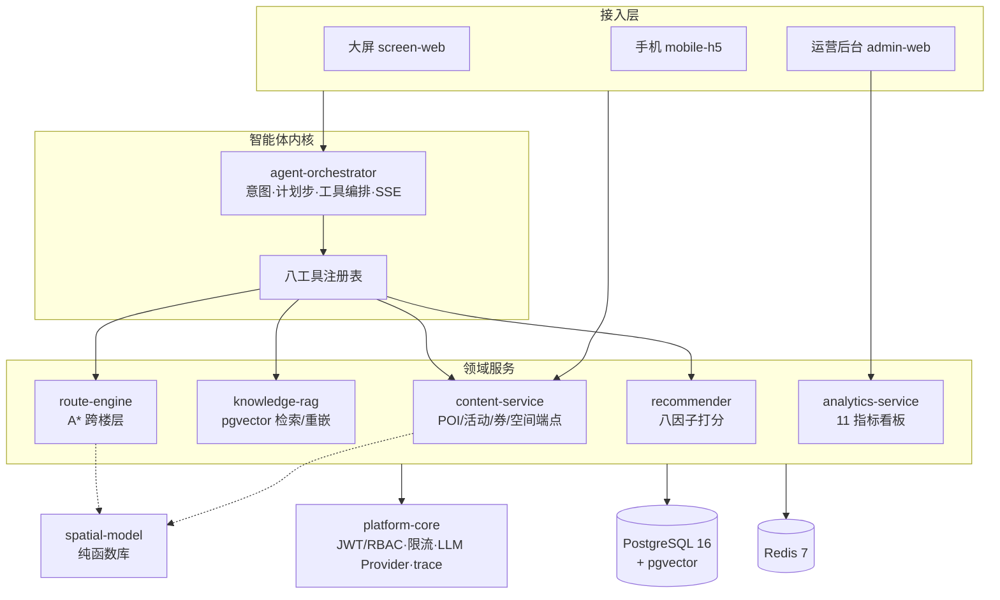
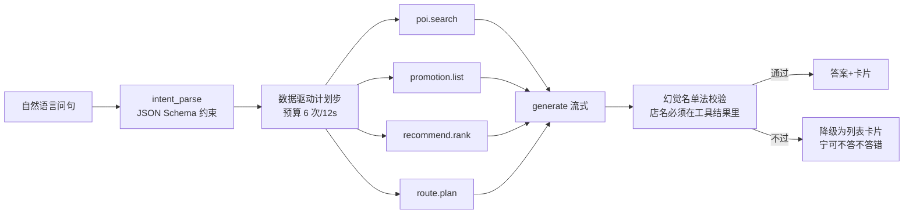

# SAGE · 场景无关的空间智能体导视平台

[](https://github.com/WenYu0306/sage-spatial-agent-guidance-engine/actions/workflows/ci.yml)
[](./LICENSE)

**一句话**：多租户空间智能体导视内核（LangGraph 编排 + pgvector RAG + 自研路径引擎 + 商业后台），
首个验证场景是商场 AI 导视。**核心验证：换第二个场景时代码零改动**——只换数据、底图与配置。

- 🌐 公网 demo：**https://sage.westwardecho.com**（运营后台 `/admin/`）
- 📖 难点解析：[Agent 编排](docs/highlights/01-agent-orchestration.md) · [换场景零改码](docs/highlights/02-scene-portability.md) · [从 demo 到公网](docs/highlights/03-production-hardening.md)
- 🎬 演示视频脚本：[docs/video-script.md](docs/video-script.md) · 投递材料包：[docs/release-package.md](docs/release-package.md)

## 架构



一次问答的数据流（每步落 trace 可回放）：



## 硬数字（口径见对应台账）

| 指标 | 值 | 出处 |
| :-- | :-- | :-- |
| AI 行为评测 | 30 条（20 正常+10 陷阱），首轮 **90%**，方差带 77-90% | packages/agent-orchestrator/EVAL_baseline.md |
| 后端 / 前端测试 | **296** pytest + **47** node:test 全绿 | CI（backend+frontend 双 workflow） |
| 故障演练 | 6 场景 **16 断言** | scripts/chaos_test.sh |
| 换场景体检 | 八项 × 2 场地 PASS | scripts/scene_check.py |
| 路网规模 | 演示场地 106 节点/224 边 → 新场地 2,243 节点/2,499 边 | EVAL_baseline.md 换场景验收表 |
| 缺陷台账 | 每条 bug 带复现测试路径 | BUGFIX_LOG.md |

## 快速开始

```bash
cp .env.example .env          # 填 DATABASE_URL / JWT_SECRET(openssl rand -hex 32) / LLM key
docker compose up -d          # 起 postgres + redis
make migrate && make seed     # 建表 + 灌演示商场（山雀里·栖云广场）
make ingest                   # 知识文档向量化（无 LLM key 时自动 Mock 嵌入）
make test                     # 296 pytest + 47 node:test
python scripts/run_agent_eval.py        # 30 条评测基线
python3 scripts/scene_check.py         # 换场景八项体检
```

单模块独立运行（每个模块不依赖兄弟服务可起）：`cd packages/<module> && make demo`（前端 `pnpm demo`）。
生产/demo 形态：`deploy/compose.demo.yml`（nginx 静态 + API 分流 + 七服务）。

## 在线 demo

| 入口 | 地址 | 说明 |
| :-- | :-- | :-- |
| 大屏/后台 | https://sage.westwardecho.com | 运营后台在 `/admin/`；演示口令线下提供（不写入仓库与聊天） |
| 本地大屏 | 大屏 screen-web dev server | kiosk 问答 + 路线 + 扫码接力 |

## 模块地图（15 包）

| 包 | 一句话 | 端口 | 复用性 |
| :-- | :-- | :-- | :-- |
| api-contract (M0) | OpenAPI 契约 + 生成模型 + 错误码表 | — | 契约先行范本 |
| platform-core (M1) | JWT/RBAC、限流、事件 SDK、LLM Provider、trace 工具 | 库 | 直接摘用 |
| route-engine (M3) | networkx A* + 跨楼层权重（电梯/扶梯预计算） | 8942 | 换权重即换场景 |
| spatial-model (M2) | 距离/最近排序/连通分量纯函数 | 库 | 零依赖摘走 |
| agent-orchestrator (M5) | 意图→计划步→工具编排→SSE→幻觉校验 | 8941 | 内核可复用 |
| knowledge-rag (M6) | 切片→嵌入→pgvector→重排→阈值（含增量重嵌） | 8943 | 自建 RAG 管道范本 |
| recommender (M7) | 八因子打分纯内核 + features 装配 | 8944 | 业务词零内核 |
| content-service (M8) | POI/活动/券状态机 + 空间端点 + RBAC 落地 | 8945 | 多租户 CRUD 范本 |
| analytics-service (M9) | events 打点 + 11 指标读端点 | 8946 | 埋点-聚合范本 |
| map-render (M4) | 分层 SVG 底图 + 画线 + 拾点 + trace 时间线 | 5190/5191 | 任意室内 SVG |
| admin-web (M10) | 12 页后台（React19 + 自绘组件，无重型框架） | 5193 | 中后台起步模板 |
| screen-web (M11) | 大屏 kiosk：问答/路线/轮播/二维码接力 | 5191 | 展厅/门店屏 |
| mobile-h5 (M12) | 接力落地 + 访客问答 + 领券（免登录 guest） | 5194 | 扫码场景通用 |
| voice-adapter / avatar-adapter | 语音/数字人灰态占位（接口先立） | — | 预留扩展位 |

## 仓库导航

- [ARCHITECTURE.md](ARCHITECTURE.md) — 分层架构、模块契约、错误码总表
- [PRD.md](PRD.md) — 功能编号 F-xx、数据模型、验收标准、评测问句
- [DECISIONS.md](DECISIONS.md) — 28 条技术决策记录（D-027 底图、D-029 换场景架构在此）
- [REUSE.md](REUSE.md) — 依赖选型台账（最小陌生面原则）
- [ASSUMPTIONS.md](ASSUMPTIONS.md) — demo 简化假设 A1-A16 与转生产条件
- [BUGFIX_LOG.md](BUGFIX_LOG.md) — 缺陷台账（现象/根因/复现测试/修复位置）
- [CLAUDE.md](CLAUDE.md) — 工程纪律（方案先行、TDD、契约边界）

## License

PolyForm Noncommercial 1.0.0 —— 非商用自由使用与修改；商用授权另议。
